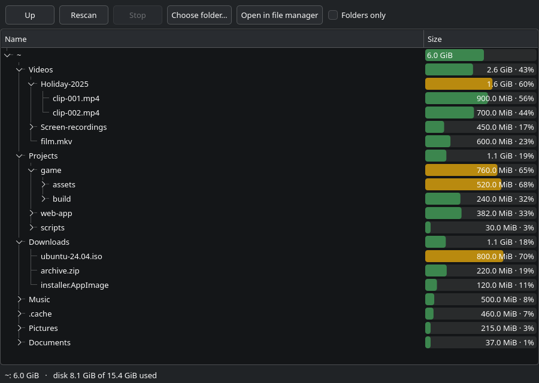

<div align="center">


# Disk Tree

**Where did all my disk space go?** Expand folders to see what's taking up space, with a bar and a percentage on every row.

[](https://github.com/1ewisd/disk-tree/actions/workflows/ci.yml)




</div>

## Why

Most disk-usage tools either make you scan the whole drive first or bury the answer in a chart. Disk Tree is just a
tree: open a folder, see what's in it, biggest first, each row showing its size and **its share of the folder it sits in**.
Click down into the heavy folder, find the 900 MiB video you forgot about, and move it to the Trash from the same window.

## Features

- **Expand as you go.** Folders list instantly; their sizes fill in live as they're measured in the background.
- **Bars and percentages** on every row, coloured green / amber / red by how much of the parent it takes.
- **Fast.** Parallel scanning, and every folder measured on the way is cached, so opening a sub-folder you've already sized is instant.
- **Honest sizes.** Uses allocated disk space like `du` (sparse VM images don't look huge), counts hard links once, skips symlinks, and doesn't wander onto other drives.
- **Never freezes.** Scans run off the UI thread, and you can **Stop** one (`Esc`) or **Rescan** (`F5`).
- **Clean up from the tree.** Right-click for Open, Show in file manager, Copy path, Scan this folder as root, Rescan this folder and **Move to Trash**. The sizes above it update straight away, no rescan needed. Nothing is ever permanently deleted.
- **Folders only** toggle, **Up** to the parent (`Backspace`), and a status bar with the total and disk usage.

## Install

```bash
git clone https://github.com/1ewisd/disk-tree.git
cd disk-tree
./install.sh
```

No root needed. It puts a private Python environment in `~/.local/share/disktree`, the `disktree` command in
`~/.local/bin`, and a **Disk Tree** entry (with icon) in your app menu.

**Requirements:** Linux, Python 3.10 or newer (with `venv`) and about 150 MB for Qt. The installer checks all of this,
names the exact package to install if something's missing (e.g. `sudo apt install python3-venv`), and verifies that
Qt starts. Options: `--system-packages` to reuse PySide6 from your distro, `--python /path/to/python3`.
Re-run it to upgrade. To remove everything: `./uninstall.sh`.

## Use

```bash
disktree             # scan your home folder
disktree /var        # scan a specific folder
disktree --version
```

| Key | Action |
|-----|--------|
| `F5` | Rescan (forgets cached sizes) |
| `Esc` | Stop the current scan |
| `Backspace` | Scan the parent folder |
| `Delete` | Move the selected item to the Trash |

## How it compares

Great tools already exist: [Baobab](https://apps.gnome.org/Baobab/), [Filelight](https://apps.kde.org/filelight/),
[QDirStat](https://github.com/shundhammer/qdirstat) and the terminal-based [ncdu](https://dev.yorhel.nl/ncdu).
Disk Tree doesn't try to beat them at everything. It aims to be the simplest "open it and drill down" view, with the
tree front and centre and no chart to interpret.

## How it works

```
src/disktree/
  scanner.py   one-pass, cancellable, cached directory sizing (st_blocks, hard-link aware)
  ui.py        the window: lazy tree, size-bar delegate, context menu, trash
  app.py       entry point
```

Each expanded folder is listed immediately, then its sub-folders are sized in parallel and reported as they finish.
Rows are updated in place, so the tree never collapses while you browse.

## Development

```bash
python -m venv .venv && . .venv/bin/activate
pip install -e ".[dev]"
pytest -q              # headless
python -m disktree     # run from source
```

## License

[MIT](LICENSE)

## Support

If this saved you some disk space (or time), a coffee is a lovely way to say thanks.

<a href="https://buymeacoffee.com/1ewis"></a>
